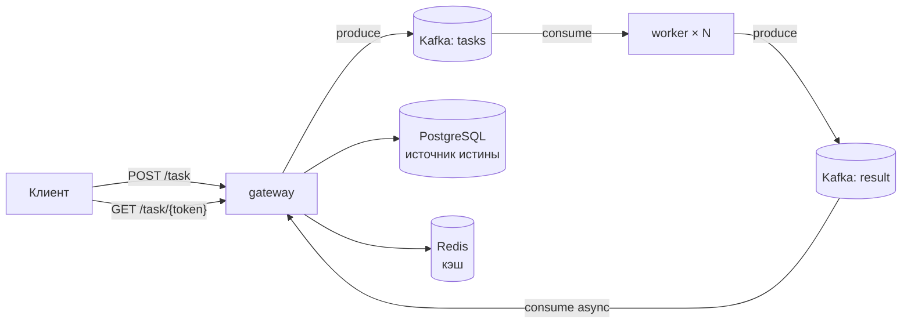

<h1 align="center">
    💻 Workers_Kafka 🎞️
</h1>


## 🗒️ Описание
Асинхронная распределённая система обработки задач: клиент ставит задачу
через HTTP-шлюз, воркеры обрабатывают её в фоне, результат забирается
опросом по токену. Построена на Kafka, PostgreSQL и Redis, разворачивается
в Kubernetes.

> В коде «задача» — это простая генерация сообщения: worker [рандомно выбирает строку из массива, искусственно ждёт (имитация тяжёлой работы)](https://github.com/chmod777v/Workers_Kafka/blob/main/worker/internal/worker/worker.go) и публикует его в `result`. 
> Цель примера — показать поток: запрос → очередь → результат, а не конкретную бизнес-логику.


## ❔ Зачем это
Демонстрирует паттерн [async request-reply](https://learn.microsoft.com/azure/architecture/patterns/asynchronous-request-reply):

- Шлюз быстро отвечает `202 Accepted` и не блокируется на обработке;
- Тяжёлая работа выполняется воркерами, которые масштабируются горизонтально (в Kubernetes — числом реплик);
- Ответ на GET кэшируется в Redis, источник истины — БД;
- Всё наблюдаемо: метрики в Prometheus и Grafana, логи в Loki;


## Архитектура

> На схеме Kafka показана как два логических топика (`tasks` и `result`), а worker — как роль. Кластер Kafka один, но состоять он может из нескольких брокеров. Воркеров может быть несколько(по задумке их много) — они масштабируются горизонтально.

### Компоненты
| Компонент | Роль |
|---|---|
| **gateway** | HTTP API: принимает `POST /task`, отвечает `202 Accepted` + токен; обслуживает `GET /task/{token}`; отдельным consumer'ом читает топик `result` и обновляет статус в БД |
| **worker** | Stateless-обработчик: читает `tasks`, выполняет задачу по `token` и публикует результат в `result`; масштабируется числом реплик |
| **Kafka** | Брокер сообщений: топик `tasks` (задачи) и `result` (результаты) |
| **PostgreSQL** | Источник истины: `token`, сообщение результата (если поле пустое => статус: "обрабатывается")|
| **Redis** | Кэш ответов GET, чтобы не бить в БД на каждом опросе |
| **Prometheus + Grafana** | Метрики и дашборды |
| **Loki + Promtail** | Сбор и просмотр логов |

### Как читать схему
- **POST-поток**: клиент → gateway → запись в БД → produce в `tasks` → `202 Accepted` с токеном. Gateway не ждёт обработки.
- **Обработка**: worker забирает задачу из `tasks`, выполняет, публикует `{token, message}` в `result`.
- **Завершение**: consumer в gateway читает `result` и обновляет сообщение в БД.
- **GET-поток**: клиент → gateway → Redis → (при промахе) PostgreSQL → ответ.
> Алгоритм работы также описан в [плане](https://github.com/chmod777v/Workers_Kafka/blob/main/plan.txt) проекта


## 🛡️ Гарантии доставки
Планируется обеспечить [exactly-once](https://habr.com/ru/companies/badoo/articles/333046/) (В процессе)


## 🛠 Технологии

### Компоненты 
| Компонент | Технология |
|---|---|
| **Язык** | `go 1.27.1`  |
| **HTTP-роутер** | `go-chi/chi/v5` |
| **Конфигурация** | `cleanenv` |
| **PostgreSQL-клиент** | `pgx/v5` |
| **Redis-клиент** | `go-redis/v9` |
| **Kafka-клиент** | `segmentio/kafka-go` |
| **Метрики** | `prometheus/client_golang` |
| **Логирование** | `slog` + `lmittmann/tint` |

### Инфраструктурные сервисы
| Слой | Технология | Образ |
|---|---|---|
| **Брокер сообщений** | Apache Kafka | `confluentinc/cp-kafka` |
| **UI для брокера сообщений** | Kafka UI | `provectuslabs/kafka-ui` |
| **База данных** | PostgreSQL | `postgres` |
| **Кэш** | Redis | `redis` |
| **Метрики** | Prometheus | `prom/prometheus` |
| **Дашборды** | Grafana | `grafana/grafana` |
| **Логи** | Loki | `grafana/loki` |
| **Сбор логов** | Promtail | `grafana/promtail` |


## 🚀 Быстрый старт

Есть два способа быстрого запуска: для локальной разработки (код на хосте, инфраструктура без мониторинга в Docker) и для проверки всей системы целиком в контейнерах.

### Способ 1: Разработка (инфраструктура в Docker, код локально)

Этот способ удобен для отладки: `gateway` и `worker` запускаются напрямую через Go, а все тяжелые сервисы — в контейнерах.

**1. Запустите инфраструктуру:**
```bash
docker compose -f ./Docker-compose-local.yaml up -d
```
>Поднимутся Kafka, PostgreSQL, Redis и Kafka-ui (Мониторинг не запуститься).

**2. Запустите `gateway` и `worker` локально.**
> Настравить для быстрого старта ничего не нужно. Подробней о конфигурации дальше.

В двух отдельных терминалах выполните:
```bash
# Терминал 1 (вы должны быть в ./gateway)
go run ./cmd

# Терминал 2 (вы должны быть в ./worker)
go run ./cmd
```

### Способ 2: Всё в Docker (полный стек)

Этот способ подходит для проверки итоговой сборки или быстрого демо, когда не нужно менять код.

```bash
docker compose -f ./Docker-compose.yaml up -d --build
```


### Доступные сервисы (Docker-compose.yaml)

После запуска всего стека доступны:

| Сервис | Адрес | Примечание |
|---|---|---|
| **Gateway API** | `localhost:8090` | Основной HTTP API |
| **Gateway Health** | `localhost:8091` | Проверка состояния (healthcheck) |
| **Worker Health** | `localhost:9091` | Проверка состояния воркера |
| **Kafka UI** | `localhost:8080` | Просмотр топиков и сообщений |
| **PostgreSQL** | `localhost:5432` | Пользователь: `postgres`, Пароль: `1234`, БД: `Tasks` |
| **Redis** | `localhost:6379` |  Кэш|
| **Prometheus** | `localhost:9090` | Метрики |
| **Grafana** | `localhost:3000` | Дашборды (admin / admin) |
| **Loki** | `localhost:3100` | Сбор логов |

>
### Проверка работоспособности

**1. Отправьте задачу (POST):**
```bash
curl -X POST http://localhost:<порт>/task \
  -H "Content-Type: application/json" \
  -d '{}'
```
*В ответ придет JSON с токеном: `{"token": "..."}`*

**2. Запросите результат (GET):**
```bash
curl http://localhost:<порт>/task/<ваш_токен>
```
- `202 Accepted` — задача в работе (загляните в Kafka UI, чтобы увидеть сообщение в топике).
- `200 OK` — задача выполнена, в теле ответа сгенерированное сообщение.

```